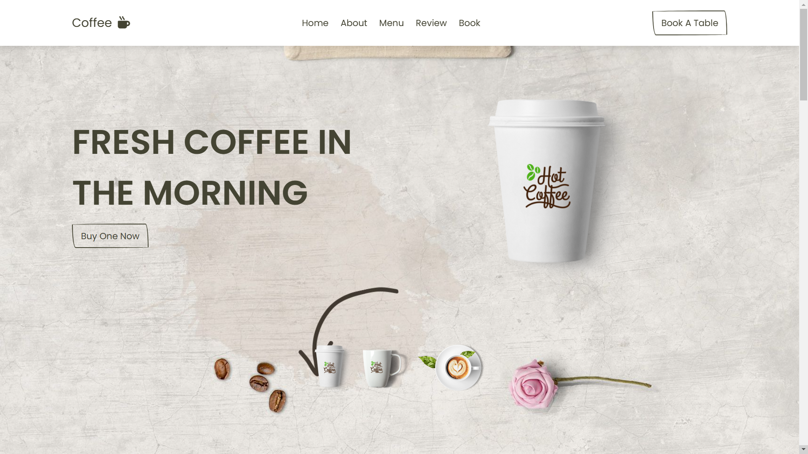

# XOXO Café



A responsive React website for XOXO Café, a cafe and patisserie in Dehradun. The site includes a home page, menu viewer, gallery, custom-cake enquiry form, online ordering links, and contact information.

## Tech stack

- React 18
- Vite
- React Router
- Tailwind CSS
- Swiper

## Getting started

### Prerequisites

- Node.js 18 or newer
- npm

### Installation

```bash
npm install
```

### Development

```bash
npm run dev
```

Open the local URL printed by Vite in your browser.

### Production build

```bash
npm run build
```

Preview the production build locally with:

```bash
npm run preview
```

## Project structure

```text
.
├── public/
│   └── image/       # Static cafe, food, menu, and brand imagery
├── src/
│   ├── components/  # Shared navigation, footer, and route utilities
│   ├── pages/       # Home, menu, gallery, order, and contact pages
│   ├── App.jsx      # Application routes and shared layout
│   ├── data.js      # Reviews and menu image data
│   └── index.css    # Tailwind layers and global styles
├── index.html
├── package.json
└── vite.config.js
```

## Available routes

- `/` — Home
- `/menu` — Menu image viewer
- `/gallery` — Cafe and food gallery
- `/order` — Custom cake enquiry form
- `/contact` — Location and contact details

## Notes

- Menu, gallery, and brand images are served from `public/image`.
- Online ordering and social links point to external services.
- The custom cake form currently validates in the browser and displays a confirmation message; connect it to a backend or form provider before using it for real enquiries.

## License

This project is intended for the XOXO Café website. Add a license file if you plan to distribute the source publicly.
